### ROBÓTICA • PROGRAMAÇÃO • ENGENHARIA • INOVAÇÃO

**Desenvolvido por Luiz, Arthur, Nayon, Eduarda, Fernanda e Nayane.**

[Repositório](https://github.com/lnzindev/rabbitech-code-for-pybricks) · [Perfil do desenvolvedor](https://github.com/lnzindev) · [Outros projetos Rabbitech](https://github.com/lnzindev?tab=repositories)

---

## 🤖 Sobre o projeto

O **Rabbitech Pybricks Autopilot** é um projeto de programação e controle robótico para o LEGO SPIKE Prime, desenvolvido por **Luiz, Arthur, Nayon, Eduarda, Fernanda e Nayane**, em João Pessoa, Paraíba.

A proposta é transformar estratégias e ideias em movimentos reais: controlar motores, executar rotinas, realizar giros com auxílio da IMU e registrar dados para aprimorar o comportamento do robô.

Este repositório faz parte da trajetória de experimentação em robótica da Rabbitech. Mais do que reunir códigos, ele documenta o desenvolvimento de soluções, testes e melhorias.

## 📸 Nossa trajetória em imagens

Registros oficiais das equipes em competições e atividades de preparação, publicados pela Prefeitura de João Pessoa.

**Tech Scorpions — etapa regional da FLL 2025/2026**

  
  

**Rabbitech — Explore** · **Rabbitech Future — Future Edition**

Fotografias: Prefeitura de João Pessoa / Secretaria de Educação.

## ⚡ Recursos do sistema

- **Controlador sequencial:** organiza até oito rotinas em uma única execução.
- **Controle de direção:** utiliza a IMU para corrigir o alinhamento durante os deslocamentos.
- **Movimento adaptativo:** mantém valores de correção que podem ser reaproveitados em execuções futuras.
- **Rampas de velocidade:** permite aceleração e desaceleração progressivas.
- **Sistema de giros:** oferece giros com duas rodas ou com apenas uma roda.
- **Monitoramento dos motores:** identifica situações em que um motor deixa de responder durante o movimento.
- **Memória persistente:** registra estatísticas e parâmetros adaptativos no armazenamento do hub.
- **Controle das garras:** permite comandar os mecanismos esquerdo e direito separadamente.

## 🧩 Organização dos arquivos

| Arquivo | Função |
|---|---|
| `main.py` | Controlador principal. Coordena as oito rotinas. |
| `base.py` | Configuração do hardware, movimentos, giros, garras e memória adaptativa. |
| `memoria.py` | Script de teste para salvar e recuperar os dados de aprendizado. |
| `saida_1.py` a `saida_8.py` | Rotinas individuais executadas pelo controlador. |

## 🔌 Configuração do robô

A configuração atual de `base.py` utiliza as seguintes portas:

| Porta | Componente |
|---|---|
| C | Motor da garra esquerda |
| D | Motor da garra direita |
| E | Motor de tração esquerdo |
| F | Motor de tração direito |

| Parâmetro | Configuração atual |
|---|---|
| Hub | LEGO SPIKE Prime |
| Diâmetro das rodas | 56 mm |
| Ambiente | Pybricks MicroPython 3.6.1 |

Confira as conexões físicas, o sentido de rotação e a montagem antes de executar o programa. Caso o robô utilize outra configuração, ajuste as definições no arquivo `base.py`.

## 🧠 Como funciona

1. O hub inicializa os motores e tenta recuperar os dados adaptativos salvos.
2. O controlador aguarda a IMU ficar pronta e interrompe o movimento dos motores de tração.
3. O visor mostra o número da próxima saída.
4. O usuário aperta e solta o **botão esquerdo** do hub para iniciar a rotina.
5. A rotina é executada e, ao terminar, o controlador para os motores.
6. Se uma rotina retornar `False`, a sequência é interrompida e o visor mostra um erro.
7. Se todas forem concluídas, o visor apresenta `FIM`.

## ▶️ Como executar

1. Prepare o hub LEGO SPIKE Prime com firmware compatível com Pybricks.
2. Abra os arquivos no editor de código do Pybricks.
3. Transfira os módulos necessários para o hub.
4. Execute **`main.py`**, que é o ponto de entrada do projeto.
5. Posicione o robô em uma área segura e use o botão esquerdo para iniciar cada rotina.

> **Segurança:** teste cada rotina separadamente, em uma área livre e controlada. Verifique a direção dos motores, a fixação das peças e o movimento das garras antes de executar a sequência completa.

## 🛠️ Personalização

As configurações principais estão centralizadas em `base.py`:

- Velocidades de deslocamento e giro.
- Velocidade e ângulos das garras.
- Diâmetro das rodas.
- Parâmetros de correção de direção.
- Tolerância e tempo limite dos giros.
- Limites da memória adaptativa.

Faça alterações gradualmente e valide cada mudança no robô físico.

## 🚧 Estado atual e próximos passos

O projeto está em desenvolvimento. No estado atual do repositório, os arquivos `saida_1.py` a `saida_8.py` ainda contêm a mesma sequência de movimentos de exemplo. Cada arquivo precisa receber sua rotina definitiva antes de ser utilizado em uma apresentação ou competição.

Outros objetivos de evolução:

- Documentar cada rotina e sua missão correspondente.
- Registrar resultados dos testes de movimento.
- Melhorar a calibração dos giros e deslocamentos.
- Evoluir o sistema de memória adaptativa.
- Manter o código modular, legível e fácil de manter.

## 🏆 Trajetória em robótica e competições

As equipes da Escola Municipal Antônio Santos Coelho Neto representam João Pessoa em competições de robótica educacional. A trajetória reúne resultados na FIRST LEGO League, projetos de inovação e participação em diferentes modalidades.

### Tech Scorpions — FIRST LEGO League Challenge 2025/2026

Na etapa regional realizada em São Luís (MA), a equipe **Tech Scorpions**, da Escola Municipal Antônio Santos Coelho Neto, conquistou:

- **1º lugar em Core Values**, reconhecimento ligado à colaboração, ao respeito, à cooperação e à ética.
- **3º lugar em Desempenho do Robô**, resultado relacionado à eficiência técnica, à programação e à precisão nas missões.

A Prefeitura publicou como integrantes da equipe **Arthur Wesley Oliveira de Lima, Luiz, Nayon Gabryel Trajano Silva, Luccas Samuell Liberato Silva e Cibelly Silva Vasconcelos**. A professora **Maria Olga Pessoa Zacchi** aparece como mediadora. A publicação também registra um depoimento de Nayon sobre a surpresa e a alegria da equipe com o prêmio de Core Values.

### Rabbitech — temporada nacional de 2026

Em 2026, a equipe **Rabbitech**, também vinculada à Escola Municipal Antônio Santos Coelho Neto, conquistou o **1º lugar na FLL Explore no Torneio Pessoense de Robótica**, resultado que garantiu classificação para a etapa nacional no Rio de Janeiro.

Na etapa nacional, realizada em outubro de 2026, a Rabbitech alcançou a **2ª colocação geral na categoria Explore** e recebeu o prêmio **Challenge Solution**, relacionado às soluções apresentadas aos desafios da competição. A participação em uma etapa mundial foi noticiada como dependente da confirmação das vagas disponíveis.

### Rabbitech Future — Future Edition

A escola também participou com a equipe **Rabbitech Future** na categoria **Future Edition**. Reportagens sobre a competição de outubro de 2026 descrevem o grupo como a **primeira equipe do Nordeste a participar dessa modalidade em uma competição nacional realizada no Brasil**.

A temporada **BIOGLOW** é voltada à biodiversidade. Na preparação para a Future Edition, os estudantes pesquisaram a germinação de sementes e testaram formas de proteção para favorecer o desenvolvimento das plantas em solos mais difíceis e com pouca água. Em paralelo, a equipe preparada para a **Founders Edition** desenvolveu uma proposta diferente: preservar e monitorar rios da cidade por meio de uma estação com sensores para acompanhar o Rio do Cabelo, próximo à escola. São projetos de modalidades distintas.

### Estudantes e orientação citados nas publicações

Na cobertura da etapa nacional de outubro de 2026, a Prefeitura publicou a relação conjunta dos estudantes que representaram a Escola Municipal Antônio Santos Coelho Neto nas equipes **Rabbitech** e **Rabbitech Future**: Jamilly Vithoria, Laysa, Heloisa, Yohanna, Lunna, Thauanny, Nayane, Luiz, Arthur e Jamilly Tayonara. A mediadora indicada foi **Maria Olga Pessoa Zacchi**. A publicação não separa os estudantes por modalidade, então a lista é mantida como uma delegação conjunta.

### Fontes públicas

- [Prefeitura de João Pessoa — Tech Scorpions: resultados da FIRST LEGO League Challenge 2025/2026](https://www.joaopessoa.pb.gov.br/noticias/rede-municipal-de-ensino-de-joao-pessoa-e-a-unica-do-brasil-a-conquistar-tres-categorias-da-first-lego-league-challenge-2025-2026/)
- [Jornal A União — cobertura da etapa regional da FLL 2025/2026 (11/02/2026)](https://auniao.pb.gov.br/servicos/copy_of_jornal-a-uniao/2026/fevereiro/jornal-em-pdf-11-02-26-cdepc.pdf)
- [Giro ES — Torneio Pessoense de Robótica define equipes classificadas](https://www.giroes.com.br/noticia/36197/torneio-pessoense-de-robotica-define-equipes-que-representarao-joao-pessoa-em-competicoes-nacional-e-regional)
- [Giro ES — premiação dos estudantes no Torneio Pessoense de Robótica](https://www.giroes.com.br/noticia/38255/leo-bezerra-premia-alunos-vencedores-do-torneio-pessoense-de-robotica-que-representarao-joao-pessoa-em-competicoes-nacionais-e-regionais)
- [Paraíba Hub — preparação para as categorias Future Edition e Founders Edition (01/10/2026)](https://paraibahub.com.br/noticia/parque-arruda-camara-recebe-alunos-da-rede-municipal-que-disputarao-torneios-de-robotica)
- [Paraíba em Movimento — resultados nacionais e relação de estudantes (outubro de 2026)](https://paraibaemmovimento.com/escolas-municipais-de-joao-pessoa-conquistam-1o-e-2o-lugares-em-competicao-nacional-de-robotica/)
- [Tribuna PB — Rabbitech, Rabbitech Future e resultados da etapa nacional (18/10/2026)](https://tribunapb.com.br/2026/10/18/alunos-de-escolas-publicas-de-joao-pessoa-conquistam-titulo-nacional-de-robotica-e-garantem-vaga-em-mundial-nos-estados-unidos/)

---

## RABBITECH

**Da ideia ao código. Do código ao movimento.**

Desenvolvido por **Luiz, Arthur, Nayon, Eduarda, Fernanda e Nayane** · João Pessoa, Paraíba, Brasil.

[GitHub](https://github.com/lnzindev) · [Ver repositório](https://github.com/lnzindev/rabbitech-code-for-pybricks)

Construir. Testar. Aprender. Evoluir.

